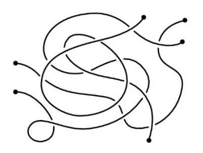
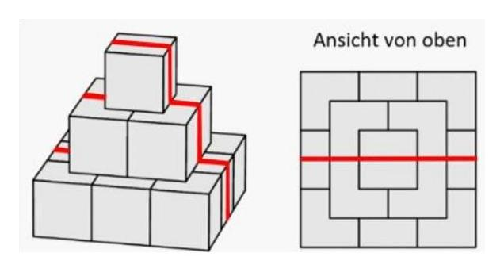
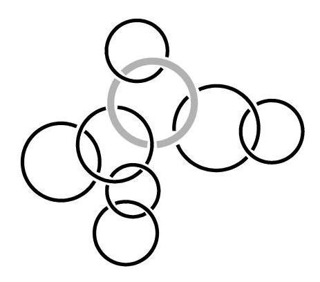
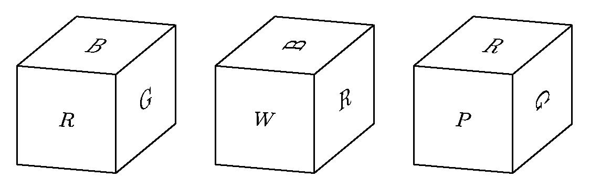
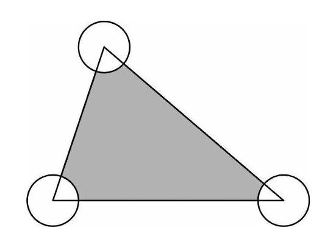
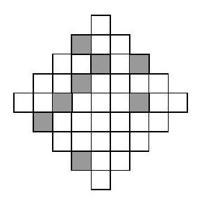

# Paired casebook

These cases illustrate outcomes; they were selected after observing results and are not a second evaluation sample. Full predictions remain in the raw JSONL files. Answer correctness is distinct from reasoning quality.

## ID 51  vl_improved

How many ropes can you see in this picture?
<image1>



Options: []

Reference: 3. Qwen answer: 10. VL answer: 3.

### Qwen output excerpt

```text
10
```

### VL-Rethinker output excerpt

```text
3
```

## ID 674  vl_improved

A pyramid is built from cubes (see diagram)
All cubes have side length $10 \mathrm{~cm}$.
An ant crawls along the line drawn across the pyramid (see diagram).
How long is the path taken by the ant?
<image1>



Options: ["$30 \\mathrm{~cm}$", "$60 \\mathrm{~cm}$", "$70 \\mathrm{~cm}$", "$80 \\mathrm{~cm}$", "$90 \\mathrm{~cm}$"]

Reference: E. Qwen answer: C. VL answer: E.

### Qwen output excerpt

```text
To determine the length of the path taken by the ant, we need to analyze the structure of the pyramid and the path it follows.

1. **Identify the Path**: The path the ant takes is a straight line that goes from one corner of the bottom layer to the opposite corner of the top layer, passing through the middle layers.

2. **Visualize the Layers**: The pyramid consists of 4 layers of cubes. Each layer is a square, and the side length of each cube is 10 cm. Therefore, the side length of the squares at different levels are as follows:
   - Bottom layer: \(10 \times 4 = 40 \text{ cm}\)
   - Second layer: \(10 \times 3 = 30 \text{ cm}\)
   - Third layer: \(10 \times 2 = 20 \text{ cm}\)
   - Top layer: \(10 \times 1 = 10 \text{ cm}\)

3. **Calculate the Path Length**: The path the ant takes can be visualized as a right triangle where the horizontal distance is the sum of the side lengths of the squares at the bottom and top layers, and the vertical distance is the sum of the side lengths of the squares at the second and third layers.

   - Horizontal distance: \(40 + 10 = 50 \text{ cm}\)
   - Vertical distance: \(30 + 20 = 50 \text{ cm}\)

4. **Use the Pythagorean Theorem**: The length of the path is the hypotenuse of a right triangle with legs of 50 cm each.
   \[
   \text{Path length} = \sqrt{50^2 + 50^2} = \sqrt{2500 + 2500} = \sqrt{5000} = 50\sqrt{2} \approx 70.71 \text{ cm}
   \]

However, since the options provided are whole numbers, we need to check the closest option. The clo
```

### VL-Rethinker output excerpt

```text
To determine the length of the path taken by the ant, we need to calculate the total distance it travels along the edges of the cubes. The ant's path is shown in the diagram with red lines.

1. **Identify the path segments:**
   - The ant moves horizontally along the top face of the smallest cube.
   - It then moves vertically down to the next level.
   - It moves horizontally along the face of the next cube.
   - It moves vertically down again.
   - It moves horizontally along the face of the next cube.
   - It moves vertically down to the bottom face.
   - It moves horizontally along the bottom face.

2. **Calculate the length of each segment:**
   - The top horizontal segment is \(10 \text{ cm}\).
   - The vertical segment is \(10 \text{ cm}\).
   - The next horizontal segment is \(20 \text{ cm}\).
   - The next vertical segment is \(10 \text{ cm}\).
   - The next horizontal segment is \(10 \text{ cm}\).
   - The next vertical segment is \(10 \text{ cm}\).
   - The bottom horizontal segment is \(30 \text{ cm}\).

3. **Sum the lengths of all segments:**
   \[
   10 + 10 + 20 + 10 + 10 + 10 + 30 = 90 \text{ cm}
   \]

Therefore, the length of the path taken by the ant is \(\boxed{E}\).
```

## ID 1414  vl_regressed

The rings shown are partially interlinked. How long is the longest chain built this way which also contains the thick light ring?
<image1>



Options: []

Reference: 5. Qwen answer: 5. VL answer: 4.

### Qwen output excerpt

```text
To solve the problem, we need to identify the longest chain of interconnected rings that includes the thick light ring.

1. **Identify the thick light ring**: The thick light ring is the one in the center of the image.
2. **Trace the longest chain including the thick light ring**:
   - Start from the thick light ring.
   - Move clockwise around the thick light ring and trace the connections.
   - The longest chain will be the one that goes through all connected rings without repeating any ring.

By tracing the connections:
- The thick light ring is connected to two other rings.
- From these two rings, we can trace further connections to reach more rings.

Following the connections:
- Thick light ring -> Ring 1 -> Ring 2 -> Ring 3 -> Ring 4 -> Ring 5

This forms a chain of 5 rings, including the thick light ring.

Thus, the longest chain built this way which also contains the thick light ring is 5 rings.

\boxed{5}
```

### VL-Rethinker output excerpt

```text
To determine the length of the longest chain that includes the thick light ring, let's analyze the image step by step:

1. Identify the thick light ring: It is the middle ring in the top row.
2. Trace the longest chain that includes this ring:
   - Start at the thick light ring.
   - Move clockwise around the ring to the next ring.
   - Continue moving clockwise until you return to the starting ring.

Following these steps:
- The thick light ring is connected to two other rings.
- Moving clockwise from the thick light ring, the next ring is connected to two more rings.
- Continuing this pattern, you can see that the longest chain including the thick light ring is a cycle that goes through all the rings connected to it without repeating any ring.

Counting the rings in this chain:
- Thick light ring + 3 other rings = 4 rings.

Therefore, the length of the longest chain built this way which also contains the thick light ring is \boxed{4}.
```

## ID 2760  vl_regressed

The faces of a cube are painted in six different colors: red (R), white (W), green (G), brown (B), aqua (A), and purple (P). Three views of the cube are shown below. What is the color of the face opposite the aqua face?
<image1>



Options: ["$\\text{red}$", "$\\text{white}$", "$\\text{green}$", "$\\text{brown}$", "$\\text{purple}\n$"]

Reference: A. Qwen answer: \text{A}. VL answer: E.

### Qwen output excerpt

```text
To determine the color of the face opposite the aqua face, we need to analyze the given views of the cube and deduce the positions of the other faces.

1. **Identify the positions of the known faces:**
   - From the first view, we see the faces labeled as B, G, and R.
   - From the second view, we see the faces labeled as W, R, and B.
   - From the third view, we see the faces labeled as R, P, and G.

2. **Determine the position of the aqua face:**
   - The aqua face (A) must be on one of the remaining faces that are not yet identified in any of the views.
   - From the first view, we know B, G, and R are on three different faces.
   - From the second view, we know W, R, and B are on three different faces.
   - From the third view, we know R, P, and G are on three different faces.
   - Since B appears in both the first and second views, it cannot be adjacent to A. Similarly, R appears in all three views, so it cannot be adjacent to A either.
   - This leaves us with the possibility that A is on the face that is not shared by B or R in any of the views.

3. **Determine the position of the opposite face:**
   - The face opposite the aqua face (A) must be the one that is not adjacent to A in any of the views.
   - From the first view, the face opposite B could be G or R.
   - From the second view, the face opposite W could be R or B.
   - From the third view, the face opposite P could be G or R.
   - The only face that is consistently not adjacent to A in all views is the red fa
```

### VL-Rethinker output excerpt

```text
To determine the color of the face opposite the aqua face, we need to analyze the given views of the cube and deduce the positions of the colors relative to each other.

1. **First View**: The front face is red (R), the right face is green (G), and the top face is brown (B).
2. **Second View**: The front face is white (W), the right face is red (R), and the top face is black (this is not a color, so we ignore it for now).
3. **Third View**: The front face is red (R), the right face is purple (P), and the top face is black (again, this is not a color, so we ignore it for now).

From the first view, we know:
- R is on the front.
- G is on the right.
- B is on the top.

From the second view, we know:
- W is on the front.
- R is on the right.
- The top face is black, but we can ignore this as it is not a color.

From the third view, we know:
- R is on the front.
- P is on the right.
- The top face is black, but we can ignore this as it is not a color.

Now, let's summarize the information:
- R is on the front in the first view and the third view.
- G is on the right in the first view.
- P is on the right in the third view.
- W is on the front in the second view.

From the first view, we can deduce:
- B is on the top.
- G is on the right.
- R is on the front.
- The left face must be the remaining color, which is aqua (A).

So, the color of the face opposite the aqua face is purple (P).

Therefore, the correct answer is \boxed{E}.
```

## ID 1324  both_correct

The area of the shown triangle equals $80 \mathrm{~m}^{2}$. Each circle has a radius of $2 \mathrm{~m}$ and itôs centre is in one of the vertices of the triangles. What is the area of the grey shaded region (in $\mathrm{m}^{2}$)?
<image1>



Options: ["76", "$80-2 \\pi$", "$40-4 \\pi$", "$80-\\pi$", "$78 \\pi$"]

Reference: B. Qwen answer: 80-2\pi. VL answer: B.

### Qwen output excerpt

```text
To solve the problem, we need to determine the area of the grey shaded region in the triangle. Let's break down the steps:

1. **Calculate the area of the triangle:**
   The area of the triangle is given as \(80 \mathrm{~m}^2\).

2. **Calculate the area of the sectors of the circles:**
   Each circle has a radius of \(2 \mathrm{~m}\) and each sector is a \(60^\circ\) angle (since the triangle is equilateral, each angle is \(60^\circ\)).
   
   The area of one sector of a circle with radius \(r\) and central angle \(\theta\) (in radians) is given by:
   \[
   \text{Area of sector} = \frac{\theta}{360^\circ} \times \pi r^2
   \]
   Here, \(\theta = 60^\circ\), so \(\theta = \frac{60^\circ}{360^\circ} = \frac{1}{6}\) radians.
   
   Therefore, the area of one sector is:
   \[
   \text{Area of one sector} = \frac{1}{6} \times \pi \times 2^2 = \frac{1}{6} \times \pi \times 4 = \frac{4\pi}{6} = \frac{2\pi}{3}
   \]
   
   Since there are three such sectors, the total area of the sectors is:
   \[
   \text{Total area of sectors} = 3 \times \frac{2\pi}{3} = 2\pi
   \]

3. **Calculate the area of the grey shaded region:**
   The grey shaded region is the area of the triangle minus the area of the sectors.
   \[
   \text{Area of grey shaded region} = 80 - 2\pi
   \]

Therefore, the area of the grey shaded region is \(\boxed{80-2\pi}\).
```

### VL-Rethinker output excerpt

```text
To solve the problem, we need to determine the area of the grey shaded region in the triangle. Let's break it down step by step.

1. **Identify the area of the triangle:**
   The area of the triangle is given as \(80 \mathrm{~m}^2\).

2. **Calculate the area of the sectors of the circles:**
   Each circle has a radius of \(2 \mathrm{~m}\) and since the center of each circle is at one of the vertices of the triangle, each sector is a \(60^\circ\) angle (because the triangle is equilateral when considering the circumcenters of the sectors, which form an equilateral triangle with side length equal to the radius of the circles).

   The area of one sector is:
   \[
   \text{Area of one sector} = \frac{60}{360} \pi r^2 = \frac{1}{6} \pi (2)^2 = \frac{1}{6} \pi \times 4 = \frac{2\pi}{3}
   \]
   Since there are three such sectors, the total area of the sectors is:
   \[
   \text{Total area of the sectors} = 3 \times \frac{2\pi}{3} = 2\pi \mathrm{~m}^2
   \]

3. **Calculate the area of the grey shaded region:**
   The grey shaded region is the area of the triangle minus the area of the three sectors:
   \[
   \text{Area of the grey shaded region} = 80 - 2\pi \mathrm{~m}^2
   \]

Therefore, the correct option is \(\boxed{B}\).
```

Both final answers match the reference option, but inspect the reasoning separately; Qwen incorrectly assumes an equilateral triangle.

## ID 1542  both_incorrect

What is the least possible number of small squares that we should shade in the diagram on the right for the whole diagram to have a line of symmetry? <image1>



Options: []

Reference: 3. Qwen answer: not extracted. VL answer: 1.

### Qwen output excerpt

```text
To determine the least possible number of small squares that need to be shaded for the entire diagram to have a line of symmetry, we need to analyze the current state of the grid and identify which squares need to be shaded to achieve symmetry.

The given grid is:

```
  1 2 3 4 5 6 7 8 9 10 11 12 13 14 15 16 17 18 19 20
  21 22 23 24 25 26 27 28 29 30 31 32 33 34 35 36 37 38 39 40
  41 42 43 44 45 46 47 48 49 50 51 52 53 54 55 56 57 58 59 60
  61 62 63 64 65 66 67 68 69 70 71 72 73 74 75 76 77 78 79 80
  81 82 83 84 85 86 87 88 89 90 91 92 93 94 95 96 97 98 99 100
  101 102 103 104 105 106 107 108 109 110 111 112 113 114 115 116 117 118 119 120
  121 122 123 124 125 126 127 128 129 130 131 132 133 134 135 136 137 138 139 140
  141 142 143 144 145 146 147 148 149 150 151 152 153 154 155 156 157 158 159 160
  161 162 163 164 165 166 167 168 169 170 171 172 173 174 175 176 177 178 179 180
  181 182 183 184 185 186 187 188 189 190 191 192 193 194 195 196 197 198 199 200
  201 202 203 204 205 206 207 208 209 210 211 212 213 214 215 216 217 218 219 220
  221 222 223 224 225 226 227 228 229 230 231 232 233 234 235 236 237 238 239 240
  241 242 243 244 245 246 247 248 249 250 251 252 253 254 255 256 257 258 259 260
  261 262 263 264 265 266 267 268 269 270 271 272 273 274 275 276 277 278 279 280
  281 282 283 284 285 286 287 288 289 290 291 292 293 294 295 296 297 298 299 300
  301 302 303 304 305 306 307 308 309 310 311 312 313 314 315 316 317 318 319 320
  321 322 323 324 325 326 
```

### VL-Rethinker output excerpt

```text
To determine the least possible number of small squares that need to be shaded for the diagram to have a line of symmetry, we need to analyze the current state of the diagram and identify which squares need to be shaded to create symmetry.

1. **Identify the current state**: The diagram has a specific pattern with some squares shaded. We need to find a way to make this pattern symmetrical about either a vertical, horizontal, or diagonal line.

2. **Check for vertical symmetry**: For vertical symmetry, the pattern on the left side of a vertical line should be a mirror image of the pattern on the right side. Currently, the pattern is not symmetrical vertically. We can check if shading some squares can make it symmetrical.

3. **Check for horizontal symmetry**: For horizontal symmetry, the pattern above a horizontal line should be a mirror image of the pattern below it. Again, the current pattern is not symmetrical horizontally. We can check if shading some squares can make it symmetrical.

4. **Check for diagonal symmetry**: For diagonal symmetry, the pattern in the upper-left triangle should be a mirror image of the pattern in the lower-right triangle, and vice versa. We can check if shading some squares can make it symmetrical along a diagonal.

After analyzing the diagram, we can see that by shading the following squares, the diagram can become symmetrical:
- Shade the square in the second row and third column from the left.
- Shade the square in the third row and second col
```

Qwen truncates after producing an artificial numeric grid; VL terminates but its final answer 1 is still incorrect (reference 3). Finishing without truncation does not imply correctness.
